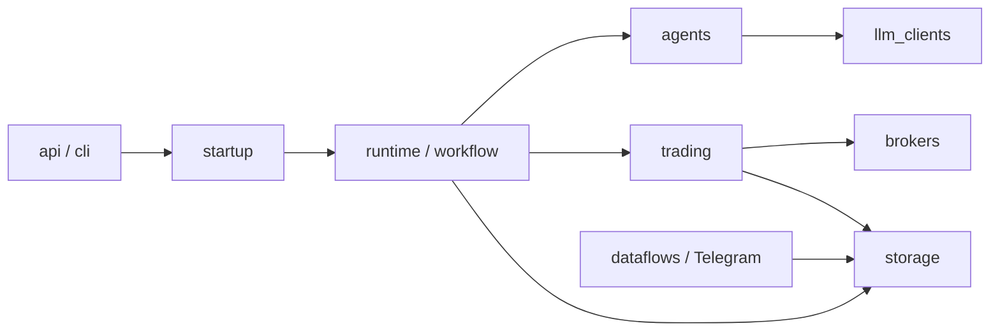

# Упрощение структуры бэкенда по примеру TradingAgents

Исторический план от 17 ноября 2026 года. Перенос исходников и явная миграция локальной установки выполнены в тот же день. Единое актуальное описание проекта, результаты проверок и состояние установки находятся в [основном руководстве](runtime.md#результаты-перехода-17-ноября-2026). Ниже сохранены исследование, карта переносов и исходные критерии готовности.

Исходный `trader`: коммит `3902b81aec6fd6d72b95ebfda3fd558341f67a62`. TradingAgents: [коммит `9fa1196`](https://github.com/TauricResearch/TradingAgents/commit/9fa1196fffbcfd9de5146d2dd2869df84ab99838) от 4 ноября 2026 года, версия 0.7.1. Это тот же внешний срез, что и в [предыдущем исследовании](tradingagents-research.md), но здесь рассматриваются расположение файлов, зависимости и переход от нашей текущей структуры.

## Рекомендация

Убрать обязательное деление на `domain / application / adapters / bootstrap` и разложить бэкенд по назначению: `agents`, `dataflows`, `llm_clients`, `brokers`, `trading`, `storage`, `api`. Очередь, общий workflow, настройки и сборку приложения оставить непосредственно в пакете `news_futures`.

Перенять у TradingAgents принцип: **по имени папки должно быть понятно, какую часть системы она содержит**. Сохранить имя Python-пакета, разделение `backend / frontend`, существующие сценарии и проверяемые границы исполнения. Переезд файлов не требует смены LangGraph, переписывания торгового алгоритма или удаления всех интерфейсов.

Исходное исследование описывало план организации исходников. Реализация сохраняет структуру `.local`, бизнес-таблицы, форматы результатов и поведение приложения; пути сериализованных типов обновляются отдельной командой миграции.

## Как устроен TradingAgents

Ниже показаны основные области, а не полный список файлов:

```text
TradingAgents/
├── main.py
├── cli/
├── tests/
├── pyproject.toml
└── tradingagents/
    ├── default_config.py
    ├── agents/
    │   ├── analysts/
    │   ├── researchers/
    │   ├── managers/
    │   ├── risk_mgmt/
    │   ├── trader/
    │   ├── schemas.py
    │   ├── state.py
    │   ├── context.py
    │   ├── structured.py
    │   └── tools.py
    ├── graph/
    │   ├── trading_graph.py
    │   ├── setup.py
    │   ├── analyst_execution.py
    │   ├── conditional_logic.py
    │   └── propagation.py
    ├── dataflows/
    │   ├── router.py
    │   └── vendors/
    ├── llm_clients/
    ├── memory/
    ├── backtest.py
    ├── portfolio.py
    ├── reporting.py
    └── report_html.py
```

Источники дерева: [корень](https://github.com/TauricResearch/TradingAgents/tree/9fa1196fffbcfd9de5146d2dd2869df84ab99838), [пакет](https://github.com/TauricResearch/TradingAgents/tree/9fa1196fffbcfd9de5146d2dd2869df84ab99838/tradingagents), [agents](https://github.com/TauricResearch/TradingAgents/tree/9fa1196fffbcfd9de5146d2dd2869df84ab99838/tradingagents/agents), [graph](https://github.com/TauricResearch/TradingAgents/tree/9fa1196fffbcfd9de5146d2dd2869df84ab99838/tradingagents/graph).

### Что делает эту структуру удобной

1. **Папки отражают предмет работы.** Роли лежат в `agents`, сборка и выполнение графа — в `graph`, источники — в `dataflows`, клиенты моделей — в `llm_clients`. Чтобы найти поставщика данных, не требуется сначала решать, к какому архитектурному слою он относится. Это оценка удобства по [структуре пакета](https://github.com/TauricResearch/TradingAgents/tree/9fa1196fffbcfd9de5146d2dd2869df84ab99838/tradingagents).
2. **Связи между областями прямые.** `TradingAgentsGraph` собирает модельные клиенты, инструменты и компоненты графа; `GraphSetup` соединяет узлы ролей. Сборка существует как обычный код, без обязательного отдельного слоя `bootstrap`. [Фасад графа](https://github.com/TauricResearch/TradingAgents/blob/9fa1196fffbcfd9de5146d2dd2869df84ab99838/tradingagents/graph/trading_graph.py), [сборка графа](https://github.com/TauricResearch/TradingAgents/blob/9fa1196fffbcfd9de5146d2dd2869df84ab99838/tradingagents/graph/setup.py).
3. **Схемы и инструменты рядом с агентами.** Общие ответы ролей находятся в `agents/schemas.py`, состояние — в `agents/state.py`, инструменты — в `agents/tools.py`. Не нужно искать их в отдельном слое сущностей. [Схемы](https://github.com/TauricResearch/TradingAgents/blob/9fa1196fffbcfd9de5146d2dd2869df84ab99838/tradingagents/agents/schemas.py), [состояние](https://github.com/TauricResearch/TradingAgents/blob/9fa1196fffbcfd9de5146d2dd2869df84ab99838/tradingagents/agents/state.py), [инструменты](https://github.com/TauricResearch/TradingAgents/blob/9fa1196fffbcfd9de5146d2dd2869df84ab99838/tradingagents/agents/tools.py).
4. **Интеграции сгруппированы внутри своей области.** `dataflows/router.py` выбирает источник операции, реализации живут в `dataflows/vendors`. Клиенты LLM выделены отдельно от рыночных данных. [Маршрутизатор данных](https://github.com/TauricResearch/TradingAgents/blob/9fa1196fffbcfd9de5146d2dd2869df84ab99838/tradingagents/dataflows/router.py), [поставщики](https://github.com/TauricResearch/TradingAgents/tree/9fa1196fffbcfd9de5146d2dd2869df84ab99838/tradingagents/dataflows/vendors), [клиенты моделей](https://github.com/TauricResearch/TradingAgents/tree/9fa1196fffbcfd9de5146d2dd2869df84ab99838/tradingagents/llm_clients).

Это моя интерпретация устройства исходников, а не утверждение авторов, что они следуют определённому архитектурному стилю. У них остаются отдельные схемы, фабрики и маршрутизация: удобная структура не означает отсутствие абстракций.

### Они уже проходили похожее упрощение

В changelog v0.5.1 описана реорганизация по содержимому: `interface` переименовали в `router`, источники сгруппировали в `vendors`, содержимое `agents.utils` распределили по именованным модулям. Позже журнал решений выделили в `memory`. При обновлениях старые пути импортов не сохраняли; для v0.5.2 отдельно оговорено ограничение возобновления старых checkpoints. Это хороший пример именования, но не готовая стратегия сохранности наших данных. [Changelog v0.5.1 и соседние изменения](https://github.com/TauricResearch/TradingAgents/blob/9fa1196fffbcfd9de5146d2dd2869df84ab99838/CHANGELOG.md#L129-L178).

### Что не стоит копировать

- **Их набор областей целиком.** Пакет `memory` и модули `portfolio.py`, `backtest.py`, `reporting.py` отвечают за существующие у них функции. Заводить такие области у нас заранее незачем. Нашему replay пока достаточно одного файла. [Пакет аналога](https://github.com/TauricResearch/TradingAgents/tree/9fa1196fffbcfd9de5146d2dd2869df84ab99838/tradingagents).
- **Все уровни вложенности ролей.** У них несколько команд и много ролей, у нас другие сценарии. Папки `analysts / managers / researchers` сейчас добавят навигацию без пользы. [Роли аналога](https://github.com/TauricResearch/TradingAgents/tree/9fa1196fffbcfd9de5146d2dd2869df84ab99838/tradingagents/agents).
- **Глобальную настройку источников как новый стандарт проекта.** У них сосуществуют process-wide конфиг dataflows и контекст запуска через `ContextVar`. Наши настройки и входы фиксируются для редакции; эту изоляцию следует сохранить. [Конфигурация dataflows](https://github.com/TauricResearch/TradingAgents/blob/9fa1196fffbcfd9de5146d2dd2869df84ab99838/tradingagents/dataflows/config.py), [наша фиксация входов](../backend/news_futures/config.py).
- **Fallback-поведение.** Их helper структурированного ответа может после ошибки запросить свободный текст, а маршрутизатор данных умеет перебирать поставщиков. У нас остаётся отказ с явной причиной, без скрытой подмены модели, источника или формата ответа. [Структурированный вызов](https://github.com/TauricResearch/TradingAgents/blob/9fa1196fffbcfd9de5146d2dd2869df84ab99838/tradingagents/agents/structured.py), [маршрутизатор](https://github.com/TauricResearch/TradingAgents/blob/9fa1196fffbcfd9de5146d2dd2869df84ab99838/tradingagents/dataflows/router.py).
- **Подмену программного риска ролью LLM.** Их `risk_mgmt` содержит участников модельной дискуссии. Наш `trading` должен содержать программный допуск, расчёт объёма, исполнение и сверку. Одинаковое слово «risk» здесь обозначает разные обязанности. [Risk-роли аналога](https://github.com/TauricResearch/TradingAgents/tree/9fa1196fffbcfd9de5146d2dd2869df84ab99838/tradingagents/agents/risk_mgmt), [наш ADR 0001](adr/0001-separate-proposals-from-execution.md).

## Что мешает в нашей структуре

На исследованном коммите в `backend/news_futures` 78 Python-файлов, из них 66 непустых, 9 699 строк Python и 10 JSON-файлов. В `backend/tests` — 23 файла `test_*.py`. Числа получены статическим подсчётом исходников; это характеристика среза, не показатель качества.

```text
news_futures/
├── domain/                  9 Python-файлов
├── application/            27 Python-файлов
│   ├── analysis/
│   ├── ports/
│   └── trading/
├── adapters/               33 Python-файла
│   ├── http/
│   ├── models/
│   ├── postgres/
│   └── tbank/
├── bootstrap/               3 Python-файла
└── common/                  4 Python-файла
```

Проблема прежде всего в расположении, а не в количестве строк:

| Что ищем | Где приходится искать сейчас | Предлагаемое место |
| --- | --- | --- |
| Торговый контур | `domain/risk.py`, `domain/terms.py`, `domain/execution.py`, `application/trading`, `application/analysis/approval.py`, `bootstrap/sandbox.py` | `trading/` |
| Настройки и пути к комплектным JSON | `application/config.py`, `domain/contracts.py`, `common/paths.py` и JSON в четырёх областях | Корневой `config.py`, общий типизированный контракт, `defaults/` |
| Запуск приложения | `__main__.py` → `adapters/cli.py` → `bootstrap/runtime.py` → `application/runtime.py` | `__main__.py` → `cli.py` → `startup.py` → `runtime.py` |
| Каталог | `domain/catalog.py`, `application/catalog.py`, `adapters/tbank/futures_catalog.py` | Обработка сохранённого каталога в `dataflows/catalog.py`, загрузка у брокера в `brokers/futures_catalog.py` |
| Граница интеграции | Контракты в `application/ports`, реализация в `adapters` | Контракты рядом с соответствующей интеграцией |

Основания: [расчёт объёма](../backend/news_futures/trading/sizing.py), [допуск](../backend/news_futures/trading/risk.py), [проверка approval](../backend/news_futures/trading/approval.py), [сборка](../backend/news_futures/startup.py), [очередь](../backend/news_futures/runtime.py), [пути](../backend/news_futures/common/paths.py), [каталог](../backend/news_futures/dataflows/catalog.py).

Два замечания о пределах упрощения:

- Отдельная сборка `startup.py` остаётся полезной: она открывает ресурсы и подключает зависимости. Перенос из `bootstrap/` сокращает навигацию; склеивать её с очередью ради удаления одного файла не требуется.
- `ports` — не только пустые интерфейсы. Там есть валидация ответов Decisions, `TradeEvidence` и `checked_publication`, задающий порядок транзакций. Удаление папки не должно удалить это поведение. [Контракты моделей](../backend/news_futures/llm_clients/contracts.py), [контракты хранилищ и транзакция](../backend/news_futures/storage/contracts.py).

## Предлагаемая структура

Ниже целевая раскладка после всех этапов. Здесь перечислены рабочие модули; пустые `__init__.py` опущены. Названия остающихся файлов в основном сохранены, чтобы перенос было проще проверить.

```text
backend/
├── Dockerfile
├── requirements.txt
├── requirements-dev.txt
├── constraints.txt
├── mypy.ini
├── tests/
└── news_futures/
    ├── __main__.py
    ├── cli.py
    ├── startup.py
    ├── runtime.py
    ├── workflow.py
    ├── config.py
    ├── credentials.py
    ├── simulation.py
    ├── replay.py
    ├── agents/
    │   ├── routing.py
    │   ├── events.py
    │   ├── decisions.py
    │   ├── review.py
    │   ├── tool_agent.py
    │   ├── schemas.py
    │   ├── calendar.py
    │   └── tool_evidence.py
    ├── llm_clients/
    │   ├── chat.py
    │   ├── decisions.py
    │   ├── groq.py
    │   ├── openrouter.py
    │   └── contracts.py
    ├── dataflows/
    │   ├── telegram.py
    │   ├── publications.py
    │   └── catalog.py
    ├── brokers/
    │   ├── tbank.py
    │   ├── mcp_orders.py
    │   ├── futures_catalog.py
    │   ├── diagnostics.py
    │   ├── diagnostic_reads.py
    │   └── contracts.py
    ├── trading/
    │   ├── account.py
    │   ├── approval.py
    │   ├── entry_context.py
    │   ├── risk.py
    │   ├── sizing.py
    │   ├── terms.py
    │   ├── execution.py
    │   ├── executor.py
    │   └── sandbox.py
    ├── storage/
    │   ├── database.py
    │   ├── publications.py
    │   ├── events.py
    │   ├── trades.py
    │   ├── checkpoints.py
    │   ├── locks.py
    │   ├── operator_state.py
    │   ├── runtime.py
    │   ├── runtime_report.py
    │   ├── migrate.py
    │   └── contracts.py
    ├── api/
    │   ├── server.py
    │   ├── news.py
    │   ├── settings.py
    │   ├── trades.py
    │   ├── supervisor.py
    │   └── worker.py
    ├── schemas/
    │   ├── contracts.py
    │   └── company.py
    ├── common/
    │   ├── artifacts.py
    │   ├── errors.py
    │   ├── paths.py
    │   └── artifact_paths.py
    └── defaults/
        ├── control.json
        ├── sandbox-settings.json
        ├── telegram-sources.json
        ├── decisions-model.json
        ├── event-model.json
        ├── events-calendar.json
        ├── groq-models.json
        ├── openrouter-models.json
        ├── futures-categories.json
        └── risk-policy.json
```

### Почему именно так

- `agents` и `llm_clients` повторяют понятное разделение аналога: логика анализа отдельно от способа вызова модели. `agents/decisions.py` проверяет и анализирует событие; `llm_clients/decisions.py` выполняет API-запрос. Совпадение имён в разных областях допустимо.
- `dataflows` содержит публикации, приём Telegram и обработку сохранённых каталогов. Связанные с Т-Банком сетевые чтения остаются у интеграции брокера, чтобы не разносить существующий REST-клиент по нескольким пакетам.
- `brokers` содержит единственную текущую интеграцию. `rest.py` становится `tbank.py`; дополнительная папка `tbank/` пока не нужна. Разделять каждый транспорт на самостоятельную иерархию не предлагается.
- `trading/risk.py` — допуск и резервирование, `sizing.py` — расчёт объёма, `execution.py` — нормализованные наблюдения и инварианты сверки, `executor.py` — внешние операции. Эти файлы имеют разные обязанности; объединять их в один большой модуль не стоит.
- `storage` сразу содержит текущую реализацию PostgreSQL. Подпапка `postgres/` не нужна, пока нет второй рабочей реализации. Исторический импорт SQLite остаётся в `migrate.py`.
- `schemas` содержит два уже существующих набора общих контрактов, которые нужны анализу, брокеру, хранилищу и торговле. Это место для форматов данных, без нового правила «всё обязано зависеть внутрь». Схемы команды агентов остаются в `agents/schemas.py`.
- `workflow.py` остаётся одним модулем: копировать многофайловый `graph/` аналога сейчас незачем. Локальные графы `review.py` и `tool_agent.py` остаются вместе со своими сценариями. Если впоследствии потребуется менять роли независимо от графа, это будет отдельная задача с конкретной причиной.
- `defaults` объединяет комплектные JSON. Корневой `config/` проекта сохраняет шаблоны профилей, `.local` — пользовательские настройки и данные. Загрузчики и строгая валидация сохраняются; Python-словарь с глобальными настройками вместо них не вводится.
- `common` остаётся маленьким набором уже используемых файлов. Добавлять универсальные `utils`, `services`, `helpers` не предлагается.

Это уменьшает глубину основных путей: `news_futures.application.analysis.tool_agent` → `news_futures.agents.tool_agent`, `news_futures.application.trading.executor` → `news_futures.trading.executor`. Цель не в минимальном числе папок: верхний уровень становится шире, но перестаёт требовать знания архитектурных слоёв.

## Карта переносов

Все пути в таблице заданы относительно `backend/news_futures/`.

| Сейчас | После перехода | Характер изменения |
| --- | --- | --- |
| `adapters/cli.py` | `cli.py` | Перенос |
| `adapters/credentials.py` | `credentials.py` | Перенос; обновить строковые mock-пути |
| `bootstrap/runtime.py` | `startup.py` | Перенос сборки зависимостей |
| `bootstrap/sandbox.py` | `trading/sandbox.py` | Перенос ручного торгового сценария |
| `application/runtime.py`, `application/workflow.py`, `application/config.py` | `runtime.py`, `workflow.py`, `config.py` | Перенос без склейки |
| `application/analysis/*.py`, кроме следующих четырёх | `agents/` с прежними именами | Перенос |
| `application/analysis/team_dto.py` | `agents/schemas.py` | Перенос и понятное имя |
| `application/analysis/approval.py`, `entry_context.py` | `trading/approval.py`, `entry_context.py` | Проверки сохранённого предложения рядом с допуском |
| `application/analysis/replay.py` | `replay.py` | Самостоятельный сценарий оценки |
| `adapters/models/*.py` | `llm_clients/` | Перенос |
| `application/ports/models.py` | `llm_clients/contracts.py` | Сохранить типы, валидаторы, фабрики |
| `adapters/telegram.py`, `domain/publications.py` | `dataflows/telegram.py`, `publications.py` | Перенос |
| `application/catalog.py` + `domain/catalog.py` | `dataflows/catalog.py` | Объединение чтения каталога и фильтрации серий |
| `adapters/tbank/*.py` | `brokers/`; `rest.py` → `tbank.py` | Перенос без изменения транспорта |
| `application/ports/broker.py` | `brokers/contracts.py` | Сохранить различие чтения и отправки заявок |
| `application/trading/*.py` | `trading/` | Перенос |
| `domain/risk.py`, `terms.py`, `execution.py` | `trading/sizing.py`, `terms.py`, `execution.py` | Перенос |
| `adapters/postgres/*.py` | `storage/` | Перенос |
| `application/ports/storage.py` | `storage/contracts.py` | Сохранить контракты, данные и порядок транзакций |
| `adapters/http/*.py` | `api/` | Перенос; обновить запуск worker как модуля |
| `domain/contracts.py`, `domain/company.py` | `schemas/contracts.py`, `company.py` | Перенос только вместе с миграцией checkpoints |
| `application/simulation.py` + `domain/simulation.py` | `simulation.py` | Объединение автономного контрольного сценария |
| `application/artifact_paths.py` | `common/artifact_paths.py` | Перенос; не смешивать типизированное чтение рынка с общей записью JSON |
| Все 10 комплектных JSON | `defaults/` | Обновить константы и чтения относительно `__file__` |
| `common/*.py`, `__main__.py`, `__init__.py` | Прежние места | Только необходимые импорты и пути |

Папки `application`, `domain`, `adapters`, `bootstrap` удаляются после переноса последнего потребителя. Пустые пакеты и файлы, которые только переэкспортируют старые имена, не оставляются.

## Какие границы сохранить



Схема показывает главные обязанности и поток управления, а не исчерпывающий граф импортов. В частности, инструменты анализа получают функции чтения рынка, а проверка approval читает типизированную трассу агентов.

Сохраняются [ADR 0001](adr/0001-separate-proposals-from-execution.md), [ADR 0002](adr/0002-langgraph-langchain-agent-workflows.md) и [ADR 0003](adr/0003-local-operator-control.md): модель формирует предложение, программный контур допускает и исполняет, панель управляет отдельным обработчиком, рабочие агентные сценарии используют LangGraph/LangChain/Pydantic.

`Protocol`, передаваемые функции чтения, фабрика моделей и объект хранилища на первом проходе сохраняются. Они позволяют подменять внешние вызовы и ограничивать полномочия. Перенос контрактов ближе к реализациям уже убирает слой `ports`. Удалять конкретный интерфейс стоит только после проверки его потребителей и тестов, а не потому, что у него одна production-реализация.

## Главный риск: перенос сохранённых Python-типов

[Сериализатор checkpoints](../backend/news_futures/storage/checkpoints.py) разрешает типы по паре `(__module__, __name__)`, в том числе `CompanyContext`, `CompanyProposal`, `Review`. После переноса из `domain` их пути изменятся. Исправленные импорты в исходниках не исправят уже сохранённые msgpack-данные.

До реализации в проекте было [преобразование старых путей](../backend/news_futures/storage/migrate.py), вызывавшееся при импорте SQLite и знавшее прежние пути `news_futures.agents.*`. Оно не мигрировало существующие данные PostgreSQL после нового переноса. [Тест импорта](../backend/tests/integrations/test_postgres_migration.py) подтверждал работу со старым `Review`, но не покрывал предлагаемый переход.

Поэтому до переезда схем нужно:

1. Создать небольшой сохранённый fixture checkpoint старым кодом: состояния с указанными моделями и незавершённые записи. Проверить также вложенные значения и фактически используемые сериализованные типы, не ограничиваться поиском трёх имён в исходниках.
2. Подготовить явную одноразовую миграцию путей типов в существующем PostgreSQL: проверить данные `checkpoint_blobs` и `checkpoint_writes`, а также остальные используемые поля сериализации установленной версии saver. Сохранить thread IDs, namespace, версии каналов, parent IDs, порядок и содержимое writes.
3. Обновить allowlist сериализатора и исторический импорт SQLite. Неизвестные пути должны приводить к понятной ошибке, а не к пропуску состояния или автоматическому новому запуску.
4. На копии базы прочитать старые checkpoints новым кодом и возобновить оба сценария, `fixed` и `tool_agent`, без повторной отправки внешних операций. Контрольный тест должен проверять результат и число вызовов исполнителя.
5. На переходе остановить API, worker и ручной sandbox-сценарий, сохранить согласованные копии базы и `.local`, выполнить миграцию и проверку. Для отката возвращать совместимые код и данные вместе.

Runtime-пути тоже являются частью данных: [имя схемы PostgreSQL](../backend/news_futures/storage/database.py) вычисляется из persistent path. Поэтому не менять `data_dir`, `TRADER_CONTAINER_LOCAL`, Docker mount `/app/backend/.local` и внутренние пути архивов вместе с реорганизацией исходников. Иначе можно получить другой набор схем и видимость «пустой базы».

## Порядок реализации

### 1. Зафиксировать исходное поведение и данные

Снять список импортов и строковых ссылок, подготовить checkpoint-fixture и копию тестовой базы. Прогнать существующие тесты и строгую проверку типов, записать исходные сбои отдельно от регрессий.

**Проверка:** известен исходный результат тестов, старые контрольные точки читаются, CLI и контрольный сценарий работают. Это проверяется до переименования модулей.

### 2. Перенести интеграции и точки входа

Перенести `adapters/models` → `llm_clients`, `adapters/postgres` → `storage`, `adapters/http` → `api`, `adapters/tbank` → `brokers`; вынести CLI, credentials и сборку на указанные места. В том же изменении обновить их потребителей, контракты из `ports`, mocks и subprocess-вызовы. Старые слои анализа и схем пока могут оставаться.

**Проверка:** CLI `--help`, тесты интеграций и панели, запуск и остановка дочернего процесса, mypy. Вызов worker должен ссылаться на `news_futures.api.worker`. Сетевые операции в контрольном сценарии по-прежнему запрещены.

### 3. Перенести анализ и собрать торговый контур

Перенести `analysis` → `agents` с исключениями из таблицы, `application/trading` → `trading`, `domain/risk` → `trading/sizing`, `terms` и `execution` → `trading`. Перенести очередь, workflow, конфиг и replay. Сохранить функции, поля схем, prompts, имена узлов графа, `TEAM_DIRECTORY`, thread IDs и форматы JSON.

**Проверка:** тесты событий, routing, review, tool evidence, replay, риска, исполнения и восстановления runtime. В частности, отказ критика, устаревшая редакция, повтор запуска, неопределённый ответ брокера и неподтверждённая защита дают прежнее поведение.

### 4. Перенести общие схемы вместе с миграцией checkpoints

Выполнить описанную выше миграцию и перенос `domain/contracts.py`, `domain/company.py`. Перенести `domain/publications.py` в `dataflows`, не меняя вычисление ID и digest.

**Проверка:** старые checkpoints и pending writes восстанавливаются, старая трасса проходит чтение approval, история публикаций и торгового журнала сохраняет идентификаторы. Если это не выполнено, переход не готов к использованию с накопленными данными.

### 5. Убрать оставшуюся раздробленность и обновить пути

Объединить два файла каталога и два файла автономной симуляции. Перенести комплектные JSON в `defaults`, обновить все прямые `with_name`, `Path(__file__)` и константы путей. Не менять копии настроек внутри уже сохранённых запусков.

Обновить документацию и проверки архитектуры. Существующий [test_architecture.py](../backend/tests/test_architecture.py) закрепляет именно старые слои: его нужно заменить небольшой проверкой действующих ограничений, например отсутствия прямого импорта concrete-клиентов отправки заявок в `agents`, и сохранить поведенческие тесты программного допуска. Не строить новую большую матрицу разрешённых импортов.

**Проверка:** новый запуск берёт defaults из новых мест; старый запуск читает собственные сохранённые входы; автономные `run / show` работают с `-I -S` без сторонних библиотек; старых импортов и ненужных пустых папок нет.

Этапы — отдельные проверяемые изменения, не обязательные отдельные релизы. Рабочую установку с накопленными данными переводить после проверки всей последовательности на копии.

## Что нужно учесть вне переносимых файлов

- **Тесты и fixtures:** все импорты в `backend/tests`, `tests/support`, строковые цели `patch`, `offline_runner.py`, новый fixture старого checkpoint. Папки тестов не обязаны зеркалить production-слои: сценарные `agents`, `trading`, `simulation`, `operator_panel` уже понятны. У `tests/adapters` при завершении перехода можно переименовать только саму группу в `integrations`; остальные группы оставить.
- **Процессы:** модуль worker в `api/supervisor.py`, его импорты в `api/worker.py`, CLI-ветки и `__main__.py`. Имена публичных CLI-команд и протокол сообщений worker сохраняются.
- **Запуск и сборка:** проверить `backend/Dockerfile`, Compose, `run-local.ps1`, поиск пакета через `PYTHONPATH`. Сохранение `backend/news_futures` позволяет оставить их основные пути и команды; редактировать только найденные ссылки на переехавшие файлы. При `COPY news_futures` папка `defaults` попадёт в контейнер вместе с пакетом.
- **Документация:** актуальные ссылки и раздел архитектуры в `docs/runtime.md`, примеры и ссылки на JSON. Прошлое исследование оставить историческим срезом; ссылки на перенесённые локальные исходники обновить либо привязать к исходному коммиту.
- **Фронтенд:** проверить прежние API-ответы и сборку панели; менять компоненты при сохранении контракта API не требуется.
- **Данные:** не переносить `.local`, не менять SQL-структуру бизнес-таблиц, имена артефактов, ID операций и форматы торгового журнала ради новой раскладки кода.

## Критерии готовности

Из `backend/`, с зависимостями из `requirements-dev.txt` и отдельной тестовой PostgreSQL-базой:

```powershell
python -m unittest discover -s tests -v
python -m mypy --strict news_futures tests
python -m news_futures --help
```

Для UI-проверок предварительно собрать `frontend` и задать `OPERATOR_TEST_CHROME`, как описано в [руководстве](runtime.md#диагностика-и-проверка). Отдельно проверить Docker- и Windows-запуск на копии данных.

Переход завершён, когда старые слои отсутствуют, каждый исходный модуль имеет понятное место, все потребители обновлены, существующие проверки проходят, старые данные читаются и возобновление не дублирует торговые операции. Сокращение числа файлов вторично: здесь запланированы только два очевидных объединения, основная польза — короткие пути и соседство связанных обязанностей.

Первоначальное исследование выполнено статическим чтением исходников; оценки ускорения работы или сокращения времени разработки не измерялись.

## Результат реализации

План реализован. Проверки сохранности, возобновления графов, результаты тестов и выполненная миграция рабочей установки описаны в [основном руководстве](runtime.md#результаты-перехода-17-ноября-2026). Для последующих установок используй [порядок обновления и отката](runtime.md#обновление-структуры-python-пакета).
