# TradingAgents и trader для краткосрочной торговли

Срез от 17 ноября 2026 года. GitHub разрешил `main` в [коммит 9fa1196fffbcfd9de5146d2dd2869df84ab99838](https://github.com/TauricResearch/TradingAgents/commit/9fa1196fffbcfd9de5146d2dd2869df84ab99838) от 4 ноября. Версия пакета `0.7.1`. Ниже статический разбор этого коммита. [Версия пакета](https://github.com/TauricResearch/TradingAgents/blob/9fa1196fffbcfd9de5146d2dd2869df84ab99838/tradingagents/__init__.py#L1-L5)

## Вывод для `trader`

У TradingAgents имеет смысл перенять стабильный интерфейс между источниками и инструментами, изоляцию контекста ролей и оценку решения по последующему рыночному исходу. У `trader` уже есть событийный вход, типизированная проверка предложений и отдельный исполнитель с журналом и сверкой. Для краткосрочных фьючерсов приоритет — получить актуальную исполнимую цену и уложить путь от редакции новости до допуска в измеримый дедлайн. Затем на одних данных измерить вклад аналитика и критика поверх базовых правил.

## Роли и граф

По умолчанию в графе **12 LLM-ролей**. При выборе `N` аналитиков остаётся `N + 8` ролей. Дополнительно `TradingAgentsGraph` всегда подключает служебный узел `Memory Log`. Он может вызывать quick-модель для рефлексии прошлых решений. Конфигурация принимает минимум одного аналитика из `market`, `social`, `news`, `fundamentals`. Имена неизвестных аналитиков приводят к ошибке. [План аналитиков](https://github.com/TauricResearch/TradingAgents/blob/9fa1196fffbcfd9de5146d2dd2869df84ab99838/tradingagents/graph/analyst_execution.py#L20-L62) · [Узлы и модели](https://github.com/TauricResearch/TradingAgents/blob/9fa1196fffbcfd9de5146d2dd2869df84ab99838/tradingagents/graph/setup.py#L109-L166) · [Подключение памяти](https://github.com/TauricResearch/TradingAgents/blob/9fa1196fffbcfd9de5146d2dd2869df84ab99838/tradingagents/graph/trading_graph.py#L82-L113)

| Роль | Число | Модель | Функция |
| --- | ---: | --- | --- |
| Market, Sentiment, News, Fundamentals Analyst | 4 | Quick | Готовят независимые отчёты о технике, настроениях, новостях и фундаментальных данных. [План аналитиков](https://github.com/TauricResearch/TradingAgents/blob/9fa1196fffbcfd9de5146d2dd2869df84ab99838/tradingagents/graph/analyst_execution.py#L20-L46) |
| Bull и Bear Researcher | 2 | Quick | Читают четыре отчёта, строят противоположные тезисы и отвечают друг другу через состояние дебатов. [Bull](https://github.com/TauricResearch/TradingAgents/blob/9fa1196fffbcfd9de5146d2dd2869df84ab99838/tradingagents/agents/researchers/bull_researcher.py#L10-L63) · [Bear](https://github.com/TauricResearch/TradingAgents/blob/9fa1196fffbcfd9de5146d2dd2869df84ab99838/tradingagents/agents/researchers/bear_researcher.py#L10-L65) |
| Research Manager | 1 | Deep | По истории дебатов формирует инвестиционный план для Trader. [Research Manager](https://github.com/TauricResearch/TradingAgents/blob/9fa1196fffbcfd9de5146d2dd2869df84ab99838/tradingagents/agents/managers/research_manager.py#L14-L72) |
| Trader | 1 | Quick | Использует план, технический отчёт при наличии и портфель. Формирует предложение Buy, Hold или Sell с опциональными абсолютными ценами входа и стопа и текстовым размером. [Trader](https://github.com/TauricResearch/TradingAgents/blob/9fa1196fffbcfd9de5146d2dd2869df84ab99838/tradingagents/agents/trader/trader.py#L20-L96) · [TraderProposal](https://github.com/TauricResearch/TradingAgents/blob/9fa1196fffbcfd9de5146d2dd2869df84ab99838/tradingagents/agents/schemas.py#L149-L188) |
| Aggressive, Conservative, Neutral Analyst | 3 | Quick | Проверяют предложение на основе отчётов под разным отношением к риску и дописывают историю своей дискуссии. [Aggressive](https://github.com/TauricResearch/TradingAgents/blob/9fa1196fffbcfd9de5146d2dd2869df84ab99838/tradingagents/agents/risk_mgmt/aggressive_debator.py#L11-L66) · [Conservative](https://github.com/TauricResearch/TradingAgents/blob/9fa1196fffbcfd9de5146d2dd2869df84ab99838/tradingagents/agents/risk_mgmt/conservative_debator.py#L11-L68) · [Neutral](https://github.com/TauricResearch/TradingAgents/blob/9fa1196fffbcfd9de5146d2dd2869df84ab99838/tradingagents/agents/risk_mgmt/neutral_debator.py#L11-L66) |
| Portfolio Manager | 1 | Deep | Читает план, предложение, риск-дискуссию, портфель и уроки памяти. Формирует финальный рейтинг и обоснование. [Portfolio Manager](https://github.com/TauricResearch/TradingAgents/blob/9fa1196fffbcfd9de5146d2dd2869df84ab99838/tradingagents/agents/managers/portfolio_manager.py#L23-L104) |

`START` запускает выбранные подграфы аналитиков и `Memory Log` параллельно. Каждый подграф видит свою историю сообщений и отдаёт родителю только своё поле отчёта. Общий барьер ждёт все входные ветки, включая память, перед `Bull Researcher`. Затем идут цикл Bull → Bear, Research Manager → Trader, цикл Aggressive → Conservative → Neutral, Portfolio Manager → `END`. Пропущенные аналитики оставляют пустые поля в состоянии, а потребители могут передать модели явную отметку о недоступности отчёта. [Подграфы и барьер](https://github.com/TauricResearch/TradingAgents/blob/9fa1196fffbcfd9de5146d2dd2869df84ab99838/tradingagents/graph/setup.py#L53-L90) · [Рёбра графа](https://github.com/TauricResearch/TradingAgents/blob/9fa1196fffbcfd9de5146d2dd2869df84ab99838/tradingagents/graph/setup.py#L142-L187) · [Начальное состояние](https://github.com/TauricResearch/TradingAgents/blob/9fa1196fffbcfd9de5146d2dd2869df84ab99838/tradingagents/graph/propagation.py#L30-L65) · [Маркер отсутствия отчёта](https://github.com/TauricResearch/TradingAgents/blob/9fa1196fffbcfd9de5146d2dd2869df84ab99838/tradingagents/agents/context.py#L190-L201)

Число исследовательских ходов ограничивает `2 * max_debate_rounds`, число риск-ходов — `3 * max_risk_discuss_rounds`. Узлы сами записывают идентификатор говорящего и увеличивают счётчик. Условные переходы читают префикс идентификатора и счётчик. Оба лимита по умолчанию равны 1, то есть после общего барьера выполняются восемь последовательных LLM-ходов. Уровни моделей сервиса по умолчанию — `gpt-6-luna` (quick) и `gpt-6-sol` (deep). Каждый уровень допускает своего провайдера и endpoint. [Условия переходов](https://github.com/TauricResearch/TradingAgents/blob/9fa1196fffbcfd9de5146d2dd2869df84ab99838/tradingagents/graph/conditional_logic.py#L4-L33) · [Запись говорящих](https://github.com/TauricResearch/TradingAgents/blob/9fa1196fffbcfd9de5146d2dd2869df84ab99838/tradingagents/agents/researchers/bull_researcher.py#L51-L63) · [Риск-счётчик](https://github.com/TauricResearch/TradingAgents/blob/9fa1196fffbcfd9de5146d2dd2869df84ab99838/tradingagents/agents/risk_mgmt/aggressive_debator.py#L48-L66) · [Конфигурация](https://github.com/TauricResearch/TradingAgents/blob/9fa1196fffbcfd9de5146d2dd2869df84ab99838/tradingagents/default_config.py#L91-L107) · [Лимиты](https://github.com/TauricResearch/TradingAgents/blob/9fa1196fffbcfd9de5146d2dd2869df84ab99838/tradingagents/default_config.py#L126-L137)

Research Manager, Trader, Sentiment Analyst и Portfolio Manager используют `with_structured_output` с Pydantic-схемами. При недоступности механизма или ошибке структурированного вызова агент запрашивает свободный текст. Структурированная схема может передаваться провайдеру как tool для вывода, без доступа к внешним источникам. Финальный рейтинг берётся из поля `final_rating` или разбирается по явной строке рейтинга. Допустимы `Buy / Overweight / Hold / Underweight / Sell`; при отсутствии однозначного распознавания возвращается `REVIEW`. Материализованный результат API — `(final_state, signal)`. [Структурированный вызов](https://github.com/TauricResearch/TradingAgents/blob/9fa1196fffbcfd9de5146d2dd2869df84ab99838/tradingagents/agents/structured.py#L31-L95) · [Обработка рейтинга](https://github.com/TauricResearch/TradingAgents/blob/9fa1196fffbcfd9de5146d2dd2869df84ab99838/tradingagents/agents/rating.py#L55-L117) · [Результат API](https://github.com/TauricResearch/TradingAgents/blob/9fa1196fffbcfd9de5146d2dd2869df84ab99838/tradingagents/graph/trading_graph.py#L167-L190)

## Инструменты и источники

Три аналитика предлагают модели **12 инструментов чтения данных** в сумме. Одна и та же константа `TOOLS` каждого аналитика используется в `llm.bind_tools(TOOLS)` и в LangGraph `ToolNode`. Идентификатор инструмента рынка и дата запуска приходят из `InjectedState`, когда того требует сигнатура. Модель выбирает доступные параметры запроса. [План аналитиков](https://github.com/TauricResearch/TradingAgents/blob/9fa1196fffbcfd9de5146d2dd2869df84ab99838/tradingagents/graph/analyst_execution.py#L20-L46) · [ToolNode](https://github.com/TauricResearch/TradingAgents/blob/9fa1196fffbcfd9de5146d2dd2869df84ab99838/tradingagents/graph/setup.py#L62-L90) · [Binding](https://github.com/TauricResearch/TradingAgents/blob/9fa1196fffbcfd9de5146d2dd2869df84ab99838/tradingagents/agents/analysts/turn.py#L13-L27) · [Сигнатуры инструментов](https://github.com/TauricResearch/TradingAgents/blob/9fa1196fffbcfd9de5146d2dd2869df84ab99838/tradingagents/agents/tools.py#L7-L94)

| Агент | Инструмент | Источники |
| --- | --- | --- |
| Market | `get_stock_data` | `yfinance` по умолчанию, также Alpha Vantage. |
| Market | `get_indicators` | `yfinance` + stockstats по умолчанию, также Alpha Vantage. |
| Market | `get_verified_market_snapshot` | Напрямую Yahoo + stockstats, вне `router.py`. С последней строкой OHLCV, фиксированным набором индикаторов и максимум 30 предыдущими строками closes. |
| News | `get_news` | `yfinance` по умолчанию, также Alpha Vantage. |
| News | `get_global_news` | `yfinance` по умолчанию, также Alpha Vantage. |
| News | `get_macro_indicators` | FRED с `FRED_API_KEY`. |
| News | `get_prediction_markets` | Polymarket, для текущих анализов. |
| Fundamentals | `get_fundamentals` | `yfinance` по умолчанию, также Alpha Vantage. |
| Fundamentals | `get_balance_sheet` | SEC EDGAR → `yfinance` по умолчанию, также Alpha Vantage. |
| Fundamentals | `get_cashflow` | SEC EDGAR → `yfinance` по умолчанию, также Alpha Vantage. |
| Fundamentals | `get_income_statement` | SEC EDGAR → `yfinance` по умолчанию, также Alpha Vantage. |
| Fundamentals | `get_insider_transactions` | `yfinance` по умолчанию, также Alpha Vantage. Настройка из категории `news_data`. |

[Списки Market](https://github.com/TauricResearch/TradingAgents/blob/9fa1196fffbcfd9de5146d2dd2869df84ab99838/tradingagents/agents/analysts/market_analyst.py#L5-L12) · [Списки News](https://github.com/TauricResearch/TradingAgents/blob/9fa1196fffbcfd9de5146d2dd2869df84ab99838/tradingagents/agents/analysts/news_analyst.py#L5-L18) · [Списки Fundamentals](https://github.com/TauricResearch/TradingAgents/blob/9fa1196fffbcfd9de5146d2dd2869df84ab99838/tradingagents/agents/analysts/fundamentals_analyst.py#L5-L20) · [Соответствие поставщиков](https://github.com/TauricResearch/TradingAgents/blob/9fa1196fffbcfd9de5146d2dd2869df84ab99838/tradingagents/dataflows/router.py#L44-L149) · [Поставщики по умолчанию](https://github.com/TauricResearch/TradingAgents/blob/9fa1196fffbcfd9de5146d2dd2869df84ab99838/tradingagents/default_config.py#L153-L171) · [Верифицированный снимок](https://github.com/TauricResearch/TradingAgents/blob/9fa1196fffbcfd9de5146d2dd2869df84ab99838/tradingagents/dataflows/vendors/yahoo/snapshot.py#L23-L117) · [Исторический guard Polymarket](https://github.com/TauricResearch/TradingAgents/blob/9fa1196fffbcfd9de5146d2dd2869df84ab99838/tradingagents/dataflows/vendors/polymarket.py#L86-L109)

Sentiment заранее загружает новости через `get_news.func`, до 30 сообщений StockTwits и посты Reddit по подходящим сообществам. Передаёт диапазон последних семи дней и опциональную проверку постов через Jev при наличии ключа TypeSafe. В момент вызова модели эти источники уже находятся в prompt. У Bull, Bear и трёх риск-аналитиков обычный `llm.invoke` с готовыми данными. [Prefetch Sentiment](https://github.com/TauricResearch/TradingAgents/blob/9fa1196fffbcfd9de5146d2dd2869df84ab99838/tradingagents/agents/analysts/sentiment_analyst.py#L43-L125) · [Jev](https://github.com/TauricResearch/TradingAgents/blob/9fa1196fffbcfd9de5146d2dd2869df84ab99838/tradingagents/agents/post_screen.py#L127-L160) · [Bull](https://github.com/TauricResearch/TradingAgents/blob/9fa1196fffbcfd9de5146d2dd2869df84ab99838/tradingagents/agents/researchers/bull_researcher.py#L42-L63) · [Bear](https://github.com/TauricResearch/TradingAgents/blob/9fa1196fffbcfd9de5146d2dd2869df84ab99838/tradingagents/agents/researchers/bear_researcher.py#L42-L65) · [Aggressive](https://github.com/TauricResearch/TradingAgents/blob/9fa1196fffbcfd9de5146d2dd2869df84ab99838/tradingagents/agents/risk_mgmt/aggressive_debator.py#L40-L66) · [Conservative](https://github.com/TauricResearch/TradingAgents/blob/9fa1196fffbcfd9de5146d2dd2869df84ab99838/tradingagents/agents/risk_mgmt/conservative_debator.py#L40-L68) · [Neutral](https://github.com/TauricResearch/TradingAgents/blob/9fa1196fffbcfd9de5146d2dd2869df84ab99838/tradingagents/agents/risk_mgmt/neutral_debator.py#L40-L66)

Подграф отправляет последнее сообщение с `tool_calls` в `ToolNode`. Выход без вызовов сразу становится отчётом. Лимит по умолчанию — **20 tool-раундов на каждого** из трёх аналитиков, где раунд — одно сообщение модели с одним или несколькими вызовами. После последнего раунда отдельный `wrap_up` преобразует историю вызовов и результатов в обычный текст, просит дописать отчёт и вызывает модель без инструментов. Ещё есть `max_recur_limit=100`, а конструктор требует, чтобы он был строго больше `2 * max_tool_rounds + 2`. При полном составе и дефолтах возможны от 12 аналитических LLM-ходов без инструментов до 72 при расходовании всех tool-раундов (3 × 21 + 1 + 8). Повторные запросы провайдеров, повтор при ошибке structured output и рефлексии добавляют вызовы. Лимиты раундов и рекурсии ограничивают переходы графа. [Маршрут подграфа](https://github.com/TauricResearch/TradingAgents/blob/9fa1196fffbcfd9de5146d2dd2869df84ab99838/tradingagents/graph/setup.py#L48-L90) · [Финальный ход](https://github.com/TauricResearch/TradingAgents/blob/9fa1196fffbcfd9de5146d2dd2869df84ab99838/tradingagents/agents/analysts/turn.py#L13-L42) · [Лимиты](https://github.com/TauricResearch/TradingAgents/blob/9fa1196fffbcfd9de5146d2dd2869df84ab99838/tradingagents/default_config.py#L132-L137) · [Проверка пределов](https://github.com/TauricResearch/TradingAgents/blob/9fa1196fffbcfd9de5146d2dd2869df84ab99838/tradingagents/graph/trading_graph.py#L84-L105)

## Маршрутизация поставщиков

`route_to_vendor` работает после того, как конкретный tool уже выбран. Он находит категорию метода, читает сначала `tool_vendors[method]`, затем `data_vendors[category]` и делит список поставщиков по запятой. Явная цепочка сохраняет порядок и фильтрует поставщиков, у которых отсутствует метод. Если явная цепочка после фильтра пуста, конфигурация завершается ошибкой. Пустая настройка или `default` без явных имён использует всех поставщиков метода в порядке словаря. Первый обычный возврат поставщика, включая текстовое сообщение об ограничении, останавливает цепочку. [Категории и конфигурация](https://github.com/TauricResearch/TradingAgents/blob/9fa1196fffbcfd9de5146d2dd2869df84ab99838/tradingagents/dataflows/router.py#L44-L94) · [Алгоритм диспетчеризации](https://github.com/TauricResearch/TradingAgents/blob/9fa1196fffbcfd9de5146d2dd2869df84ab99838/tradingagents/dataflows/router.py#L152-L259)

При исключении роутер пробует следующего поставщика из настроенной цепочки. Если успеха нет, `VendorUnavailableError` или сочетание нетипизированной ошибки с `NoMarketDataError` дают `DATA_UNAVAILABLE`. Чистый `NoMarketDataError`, в том числе после `VendorNotConfiguredError`, даёт `NO_DATA_AVAILABLE` с подробностью об инструменте. Оставшаяся первая ошибка поднимается наружу, кроме опциональных FRED/Polymarket, для которых возвращается сообщение `DATA_UNAVAILABLE`. Эта логика объясняет, почему текстовый ответ с ограничением покрытия от Yahoo не запускает следующего поставщика, а исключение из того же адаптера может его запустить. [Развилки ошибок](https://github.com/TauricResearch/TradingAgents/blob/9fa1196fffbcfd9de5146d2dd2869df84ab99838/tradingagents/dataflows/router.py#L227-L297) · [Ответы Yahoo News](https://github.com/TauricResearch/TradingAgents/blob/9fa1196fffbcfd9de5146d2dd2869df84ab99838/tradingagents/dataflows/vendors/yahoo/news.py#L87-L134)

## Точки расширения

- Поставщик для существующего метода. Реализовать сигнатуру метода в адаптере, включить его в `VENDOR_METHODS[method]` и добавить имя в `tool_vendors` или `data_vendors`. `VendorNotConfiguredError`, `VendorUnavailableError` и `NoMarketDataError` передают разные результаты диспетчеризации. [Адаптеры и реестр](https://github.com/TauricResearch/TradingAgents/blob/9fa1196fffbcfd9de5146d2dd2869df84ab99838/tradingagents/dataflows/router.py#L9-L40) · [Таблица методов](https://github.com/TauricResearch/TradingAgents/blob/9fa1196fffbcfd9de5146d2dd2869df84ab99838/tradingagents/dataflows/router.py#L96-L149) · [Маршрутизация](https://github.com/TauricResearch/TradingAgents/blob/9fa1196fffbcfd9de5146d2dd2869df84ab99838/tradingagents/dataflows/router.py#L200-L297)
- Новый инструмент. Описать его через `@tool` в `agents/tools.py`, получать нужные тикер и дату из состояния и добавить его в `TOOLS` нужного аналитика. Для инструмента с выбором источника добавить метод в `TOOLS_CATEGORIES` и `VENDOR_METHODS`. Для единственного источника паттерн `get_verified_market_snapshot` вызывает адаптер напрямую. [Определения инструментов](https://github.com/TauricResearch/TradingAgents/blob/9fa1196fffbcfd9de5146d2dd2869df84ab99838/tradingagents/agents/tools.py#L18-L94) · [Реестр методов](https://github.com/TauricResearch/TradingAgents/blob/9fa1196fffbcfd9de5146d2dd2869df84ab99838/tradingagents/dataflows/router.py#L44-L149) · [Подключение к графу](https://github.com/TauricResearch/TradingAgents/blob/9fa1196fffbcfd9de5146d2dd2869df84ab99838/tradingagents/graph/setup.py#L53-L90)
- Новый аналитик. Создать фабрику узла, добавить запись в `ANALYST_NODE_SPECS` и `analyst_factories`, объявить собственное поле отчёта в состоянии и определить начальное значение, потребителей и сохранение отчёта. [Спецификации](https://github.com/TauricResearch/TradingAgents/blob/9fa1196fffbcfd9de5146d2dd2869df84ab99838/tradingagents/graph/analyst_execution.py#L7-L62) · [Фабрики](https://github.com/TauricResearch/TradingAgents/blob/9fa1196fffbcfd9de5146d2dd2869df84ab99838/tradingagents/graph/setup.py#L109-L146) · [Начальное состояние](https://github.com/TauricResearch/TradingAgents/blob/9fa1196fffbcfd9de5146d2dd2869df84ab99838/tradingagents/graph/propagation.py#L30-L65) · [Потребитель отчётов](https://github.com/TauricResearch/TradingAgents/blob/9fa1196fffbcfd9de5146d2dd2869df84ab99838/tradingagents/agents/researchers/bull_researcher.py#L10-L45) · [Журнал](https://github.com/TauricResearch/TradingAgents/blob/9fa1196fffbcfd9de5146d2dd2869df84ab99838/tradingagents/graph/trading_graph.py#L438-L465)

## Память и побочные эффекты

- `Memory Log` параллельно с аналитиками проходит по ожидающим исходам всех тикеров. Для каждого созревшего решения берёт дневные closes Yahoo, находит первый close после даты анализа, отсчитывает ещё пять торговых дней по умолчанию и считает raw return и alpha относительно регионального бенчмарка. Бар текущего дня исключается даже в случаях, когда к моменту запроса торговля уже завершилась. Каждое решение получает отдельную рефлексию quick-модели по финальному тексту, raw return и alpha. Ошибка котировок или модели оставляет решение pending. [Узел памяти](https://github.com/TauricResearch/TradingAgents/blob/9fa1196fffbcfd9de5146d2dd2869df84ab99838/tradingagents/graph/trading_graph.py#L309-L357) · [Расчёт доходности](https://github.com/TauricResearch/TradingAgents/blob/9fa1196fffbcfd9de5146d2dd2869df84ab99838/tradingagents/memory/settlement.py#L44-L125) · [Обход памяти](https://github.com/TauricResearch/TradingAgents/blob/9fa1196fffbcfd9de5146d2dd2869df84ab99838/tradingagents/memory/settlement.py#L136-L196) · [Запрос рефлексии](https://github.com/TauricResearch/TradingAgents/blob/9fa1196fffbcfd9de5146d2dd2869df84ab99838/tradingagents/memory/reflection.py#L13-L63)
- Portfolio Manager получает по умолчанию до пяти последних разрешённых решений по анализируемому тикеру и три межтикерных урока. Исторический запуск читает записи с известной датой разрешения не позже своего дня. Память — локальный Markdown, с защитой от повторной записи по тикеру и дате. Оценку можно запускать отдельно через `settle_pending` и `settle_all_pending`. [Получение уроков](https://github.com/TauricResearch/TradingAgents/blob/9fa1196fffbcfd9de5146d2dd2869df84ab99838/tradingagents/memory/log.py#L20-L133) · [Запуск и дата отсечения](https://github.com/TauricResearch/TradingAgents/blob/9fa1196fffbcfd9de5146d2dd2869df84ab99838/tradingagents/graph/trading_graph.py#L130-L138) · [Чтение менеджером](https://github.com/TauricResearch/TradingAgents/blob/9fa1196fffbcfd9de5146d2dd2869df84ab99838/tradingagents/agents/managers/portfolio_manager.py#L26-L62) · [Публичные методы расчёта](https://github.com/TauricResearch/TradingAgents/blob/9fa1196fffbcfd9de5146d2dd2869df84ab99838/tradingagents/graph/trading_graph.py#L338-L357)
- `propagate` пишет JSON-состояние на диск и добавляет решение к ожидающим в журнале. Успешный запуск снимает опциональный SQLite checkpoint, который по умолчанию выключен. `save_reports` отдельно формирует дерево отчётов с HTML. Сетевые операции этого пути — запросы к источникам, к моделям и при включении к Jev. Portfolio Manager завершает граф рейтингом и текстом. `PortfolioContext` передаёт заданные вызывающим позиции и остаток денежных средств как контекст. API исполняет аналитический сценарий, а отправку и сопровождение ордеров должен обеспечивать вызывающий код. [Постобработка](https://github.com/TauricResearch/TradingAgents/blob/9fa1196fffbcfd9de5146d2dd2869df84ab99838/tradingagents/graph/trading_graph.py#L359-L405) · [JSON](https://github.com/TauricResearch/TradingAgents/blob/9fa1196fffbcfd9de5146d2dd2869df84ab99838/tradingagents/graph/trading_graph.py#L438-L476) · [Checkpoint и HTML](https://github.com/TauricResearch/TradingAgents/blob/9fa1196fffbcfd9de5146d2dd2869df84ab99838/tradingagents/graph/trading_graph.py#L192-L219) · [Сохранение отчётов](https://github.com/TauricResearch/TradingAgents/blob/9fa1196fffbcfd9de5146d2dd2869df84ab99838/tradingagents/graph/trading_graph.py#L277-L291) · [Контекст портфеля](https://github.com/TauricResearch/TradingAgents/blob/9fa1196fffbcfd9de5146d2dd2869df84ab99838/tradingagents/portfolio.py#L1-L38)

## Применимость к короткому горизонту

- Граница данных — `trade_date` с точностью до календарного дня. Датированные инструменты в `ToolNode` ограничивают даты по состоянию, Yahoo News фильтрует новости по UTC-дням до конца даты включительно. Внутрисессионный момент решения графу не передаётся. Дневная история Yahoo может включать текущую неполную свечу с непустым `Close`; Alpha Vantage вызывает дневной endpoint. Снимок помогает сверять точные значения индикаторов, но подтверждает только те дневные данные, которые ему вернул Yahoo. Это ограничивает пригодность цен, новостей и backtest для решения на конкретной минуте. [Ограничение дат](https://github.com/TauricResearch/TradingAgents/blob/9fa1196fffbcfd9de5146d2dd2869df84ab99838/tradingagents/dataflows/date_window.py#L19-L42) · [Запросы инструментов](https://github.com/TauricResearch/TradingAgents/blob/9fa1196fffbcfd9de5146d2dd2869df84ab99838/tradingagents/dataflows/date_window.py#L79-L111) · [Ряды Yahoo](https://github.com/TauricResearch/TradingAgents/blob/9fa1196fffbcfd9de5146d2dd2869df84ab99838/tradingagents/dataflows/vendors/yahoo/ohlcv.py#L146-L217) · [Дневной endpoint Alpha Vantage](https://github.com/TauricResearch/TradingAgents/blob/9fa1196fffbcfd9de5146d2dd2869df84ab99838/tradingagents/dataflows/vendors/alpha_vantage/stock.py#L9-L42)
- Данные исторического анализа имеют разное покрытие. EDGAR ограничивает факты датой подачи, Yahoo с ограниченной историей публикаций и Reddit/StockTwits выдают срез свежей выборки, а Polymarket для исторической даты возвращает сообщение о недоступности. Yahoo может вернуть неполную выборку новостей, даже если в окне нашлись статьи. Текущий профиль в историческом запуске сокращается до актуального имени для идентификации. Повторный запуск за ту же дату может отличаться из-за изменившихся исходных лент и генерации модели. [EDGAR](https://github.com/TauricResearch/TradingAgents/blob/9fa1196fffbcfd9de5146d2dd2869df84ab99838/tradingagents/dataflows/vendors/sec_edgar.py#L154-L224) · [Yahoo news](https://github.com/TauricResearch/TradingAgents/blob/9fa1196fffbcfd9de5146d2dd2869df84ab99838/tradingagents/dataflows/vendors/yahoo/news.py#L87-L134) · [История соцсетей](https://github.com/TauricResearch/TradingAgents/blob/9fa1196fffbcfd9de5146d2dd2869df84ab99838/tradingagents/agents/analysts/sentiment_analyst.py#L1-L17) · [Polymarket](https://github.com/TauricResearch/TradingAgents/blob/9fa1196fffbcfd9de5146d2dd2869df84ab99838/tradingagents/dataflows/vendors/polymarket.py#L86-L109) · [Историческая идентификация](https://github.com/TauricResearch/TradingAgents/blob/9fa1196fffbcfd9de5146d2dd2869df84ab99838/tradingagents/agents/context.py#L107-L161) · [Воспроизводимость в README](https://github.com/TauricResearch/TradingAgents/blob/9fa1196fffbcfd9de5146d2dd2869df84ab99838/README.md#L381-L401)
- Финальный рейтинг определяет направление экспозиции на уровне исследования. Цены входа, стоп и размер находятся в предложении Trader, причём эти поля опциональны, а размер — текст. Схема итогового Portfolio Manager добавляет опциональную целевую цену и текстовый горизонт. В результате графа нет привязки к конкретному контракту бессрочного фьючерса, размеру лота, шагу цены, исполнению, издержкам, ликвидации, funding и обработке повторной отправки. Таблица backtest проверяет знак alpha для направленных рейтингов с моделированием по дневным close. Из неё нельзя получить статистику исполненных внутридневных сделок со стопами. [Предложение Trader](https://github.com/TauricResearch/TradingAgents/blob/9fa1196fffbcfd9de5146d2dd2869df84ab99838/tradingagents/agents/schemas.py#L149-L188) · [Схема решения](https://github.com/TauricResearch/TradingAgents/blob/9fa1196fffbcfd9de5146d2dd2869df84ab99838/tradingagents/agents/schemas.py#L221-L265) · [Рейтинг и направление](https://github.com/TauricResearch/TradingAgents/blob/9fa1196fffbcfd9de5146d2dd2869df84ab99838/tradingagents/agents/managers/portfolio_manager.py#L50-L86) · [Статистика backtest](https://github.com/TauricResearch/TradingAgents/blob/9fa1196fffbcfd9de5146d2dd2869df84ab99838/tradingagents/backtest.py#L206-L236) · [Окно оценки](https://github.com/TauricResearch/TradingAgents/blob/9fa1196fffbcfd9de5146d2dd2869df84ab99838/tradingagents/memory/settlement.py#L60-L125)
- При коротком времени реакции на событие критический путь включает самого долгого аналитика или память, затем восемь последовательных LLM-ходов по умолчанию. Увеличение глубины дебатов прибавляет последовательные ходы. Ветка памяти может добавить запросы котировок и LLM-вызов за каждое ожидающее решение с созревшим окном. Статический разбор показывает структуру задержки. Фактическую задержку и качество сигнала можно установить только замерами. [Барьер и этапы](https://github.com/TauricResearch/TradingAgents/blob/9fa1196fffbcfd9de5146d2dd2869df84ab99838/tradingagents/graph/setup.py#L157-L185) · [Условия дебатов](https://github.com/TauricResearch/TradingAgents/blob/9fa1196fffbcfd9de5146d2dd2869df84ab99838/tradingagents/graph/conditional_logic.py#L12-L33) · [Рефлексии в цикле](https://github.com/TauricResearch/TradingAgents/blob/9fa1196fffbcfd9de5146d2dd2869df84ab99838/tradingagents/memory/settlement.py#L136-L196)

Авторы статьи описывают эксперимент на дневных решениях по американским акциям. Текущий открытый код надо сверять отдельно, поскольку и состав вызовов, и способ оценки менялись. Для выбора архитектуры здесь существенны гранулярность и задержка, а достоверность реакции на новость за минуту требует отдельного внутридневного эксперимента. [Статья, раздел 5](https://arxiv.org/html/2412.20138#S5) · [История релизов](https://github.com/TauricResearch/TradingAgents/blob/9fa1196fffbcfd9de5146d2dd2869df84ab99838/CHANGELOG.md)

### Что улучшить в архитектуре TradingAgents

| Наблюдение по коду | Изменение для короткого горизонта |
| --- | --- |
| `TOOLS_CATEGORIES` и `VENDOR_METHODS` описывают один метод двумя реестрами. Из явного списка молча отбрасываются поставщики без метода, пока остаётся хотя бы один рабочий. | При росте числа инструментов хранить категорию и реализации в одной записи. Проверять совместимость при сборке, явно различая выбор одного провайдера на tool и покрытие нескольких разных методов на категорию. |
| Результат маршрутизатора смешивает данные, сообщения об отсутствии данных и исключения. Модель получает эти варианты через текст результата инструмента. | Возвращать типизированное наблюдение с провайдером, временем, статусом покрытия и признаком свежести. Для обязательного рыночного чтения останавливать вход при отсутствии данных. |
| Граф аналитиков изолирует сообщения, но передаёт downstream прежде всего текстовые отчёты. Решение нескольких ролей может повторять выводы из одних данных. | Передавать идентификаторы наблюдений и проверяемые факты вместе с выводом. Считать независимость по первичным наблюдениям. |
| Барьер в начале ждёт и независимую аналитику, и урегулирование прошлых решений. | Перенести оценку исходов за пределы пути сигнала. На входе использовать готовый срез результатов по состоянию на момент решения, если его вклад подтверждён измерением. |

[Реестр поставщиков](https://github.com/TauricResearch/TradingAgents/blob/9fa1196fffbcfd9de5146d2dd2869df84ab99838/tradingagents/dataflows/router.py) · [Обмен через AgentState](https://github.com/TauricResearch/TradingAgents/blob/9fa1196fffbcfd9de5146d2dd2869df84ab99838/tradingagents/agents/state.py) · [Рёбра графа](https://github.com/TauricResearch/TradingAgents/blob/9fa1196fffbcfd9de5146d2dd2869df84ab99838/tradingagents/graph/setup.py)

## Как устроен локальный `trader`

Сравнение сделано по рабочей копии на 17 ноября 2026 года. Базовый коммит — `47673d0dc50cfa1689b1775fe5d2e72dd4516a42`. Некоторые файлы runtime, агента и исполнителя уже содержали локальные изменения. Выводы о поведении относятся к прочитанным файлам.

### От сообщения до сделки

| Этап | Ответственный модуль | Результат |
| --- | --- | --- |
| Приём | `adapters/telegram.py`, `adapters/postgres/publications.py` | Telethon читает каналы, архив хранит редакции и очередь. Ревизия — единица обработки. |
| Сборка | `bootstrap/runtime.py`, `application/runtime.py` | Runtime получает порты моделей, рынка, брокера и хранилища. Для редакции сохраняет публикацию, каталог, профиль и настройки моделей. |
| Маршрут | `application/workflow.py`, `analysis/routing.py`, `analysis/events.py` | Классификация категорий и компаний, запись события, проверка актуальности редакции, позиции, возраста и наличия фьючерса. В рабочем графе `match_route` вызывается без конфигурации модели сопоставления событий и записывает `saved`. Модельный путь для `repeat` и `update` существует отдельно. |
| Инструмент | `analysis/routing.py::select_contract` | Модель выбирает один UID из разрешённых серий или `none`. При прочих равных промпт предлагает ближайшую дату последних торгов. Перед выбором модели передаются метаданные серии, а рыночный снимок берётся далее. |
| Анализ | `analysis/decisions.py`, `analysis/review.py` или `analysis/tool_agent.py` | Вариант определяется профилем. Оба связывают предложение с фактами и проверкой критика. |
| Допуск и исполнение | `application/trading/risk.py`, `domain/risk.py`, `application/trading/executor.py` | Для предложения, допущенного к проверкам `fixed` в sandbox приложение заново читает риск-данные, проверяет версию события, резервирует вход, ведёт журнал команд и сверяет исполнение, фактически заполненный объём и защиту. В `observation` брокерский порт записи отсутствует. |
| Восстановление | `adapters/postgres/checkpoints.py`, `runtime.py`, `executor.py` | Граф возобновляет анализ по ключу редакции. Брокерский журнал хранит цикл и идентификаторы операций отдельно, позволяя сверять прерванную отправку. |

[Адаптер Telegram](../backend/news_futures/adapters/telegram.py) · [очередь PostgreSQL](../backend/news_futures/adapters/postgres/publications.py) · [сборка портов](../backend/news_futures/bootstrap/runtime.py) · [runtime](../backend/news_futures/application/runtime.py) · [граф публикации](../backend/news_futures/application/workflow.py) · [маршрутизация](../backend/news_futures/application/analysis/routing.py) · [события](../backend/news_futures/application/analysis/events.py) · [допуск](../backend/news_futures/application/trading/risk.py) · [исполнитель](../backend/news_futures/application/trading/executor.py) · [checkpoint-сериализация](../backend/news_futures/adapters/postgres/checkpoints.py)

### Роли и инструменты

| Профиль | LLM-роли в финальном анализе | Как работают инструменты | Выход |
| --- | --- | --- | --- |
| `fixed` по умолчанию | **2** — аналитик и критик | Граф заранее готовит контекст публикации, архива, рынка и счёта. Роли возвращают структурированные ответы, инструменты чтения им не привязаны. После первого отказа возможна одна доработка. | `no_action`, `rejected` или `approved_for_checks`. Последний статус разрешает перейти к программным проверкам для подходящего запуска. |
| `tool_agent` | **3** — координатор, аналитик, критик | Координатор формирует `Assignment` для компании из доступного списка. Только аналитик получает два read-only инструмента и схему финального `AnalystAnswer` через `bind_tools`. Критик проверяет точный ID предложения. | `candidate` при одобрении, а также исходы `skipped`, `insufficient_data`, `rejected`, `failed`. В `Runtime.process_revision` ветка возвращается до вызова исполнителя, в том числе в sandbox. |

Классификация категорий, привязка компаний пакетами и выбор контракта — отдельные модельные вызовы `Decisions` перед финальными ролями. Их число зависит от пути и размера каталога. В стандартной конфигурации пакет содержит до 40 компаний. Координатор по умолчанию использует настройки аналитика. Разделение ролей сохраняется и при совпадении моделей.

| Инструмент `tool_agent` | Область и проверка |
| --- | --- |
| `get_company_news(company_id)` | Только компания из задания. Читает локальный контекст до ID решения по событию, исключает текущую редакцию, ограничивает число и размер записей. |
| `get_market_context(contract_id)` | Только выбранный контракт назначенной компании. Возвращает снимок инструмента и счёта, единицу цены и признаки доступности лимитной покупки и продажи. Проверяет свежесть рынка и счёта. |

Модель выдаёт ровно один tool call за ход. `AnalystAnswer` оформлен как tool call для выбора ответа и служит схемой завершения, отдельного чтения за ним нет. Бюджеты по умолчанию — 45 секунд на `tool_agent`, до 10 секунд на вызов, 8 ходов аналитика, 7 попыток чтения и до 2 проверок критика. Успешное чтение данного типа убирает инструмент из следующих предложенных вызовов. Поэтому 7 — предел попыток, а доступных операций чтения две. Бюджет команды стартует после внешней маршрутизации. `input_budget` для проверки перед вызовом использует размер сериализованного запроса в UTF-8, а при наличии usage расход учитывает токены. Это две разные единицы для одной границы.

[Настройки профиля](../backend/news_futures/application/config.py) · [пример RuntimeSettings](../config/runtime.example.json) · [цикл fixed](../backend/news_futures/application/analysis/review.py) · [схемы handoff и tools](../backend/news_futures/application/analysis/team_dto.py) · [цикл tool_agent](../backend/news_futures/application/analysis/tool_agent.py) · [точка передачи в исполнение](../backend/news_futures/application/runtime.py)

## Что стоит перенять из TradingAgents

| Задача | TradingAgents | `trader` и решение |
| --- | --- | --- |
| Изменить источник данных | Стабильные имена tools поверх маршрутизатора и vendor adapters. | Порты для брокера, моделей и хранилища уже существуют. Переиспользовать границу адаптера, выделив рыночное наблюдение для анализа и replay. Политики замены поставщика вносить только при появлении второго подтверждённого источника. |
| Ограничить контекст ролей | Приватные подграфы аналитиков, сборка отчётов через граф. | В `tool_agent` уже есть `AnalystTask`, `MarketObservation`, `ProposalContext` и `CriticTask`. Сохранить типизированную передачу. Для первичных фактов хранить время и ссылку на наблюдение, чтобы критик мог проверить тот же снимок. |
| Параллельность | Аналитики и узел памяти работают параллельно, дебаты и финальная сводка последовательны. | Анализ редакций и батчи компаний последовательно проходят через рабочий обработчик. Независимые чтения рынка и проверка новости могут перекрываться после известного UID. Сначала измерить очередь, отмену и дедлайн. Брокерский цикл сохранить единым владельцем записи. |
| Обратная связь | Память решений и закрытий, рефлексия по прошлым прогнозам. | У `trader` есть архив ревизий, трассы, контрольные точки и журнал исполнений. Связать прогноз, котировку при решении и исход по горизонту в отчёте replay. Добавлять модельную рефлексию после проверки её вклада на отложенных данных. |
| Риск и внешний эффект | LLM-дебаты и итоговая рекомендация. | Программный допуск, сверка брокера, пауза, журнал намерений и защита уже реализованы. Новый граф анализа должен выдавать кандидата по узкому контракту, при этом исполнитель повторно проверяет право и условия заявки. |

[TradingAgents GraphSetup](https://github.com/TauricResearch/TradingAgents/blob/9fa1196fffbcfd9de5146d2dd2869df84ab99838/tradingagents/graph/setup.py) · [TradingAgents router](https://github.com/TauricResearch/TradingAgents/blob/9fa1196fffbcfd9de5146d2dd2869df84ab99838/tradingagents/dataflows/router.py) · [разделение предложений и исполнения в trader](adr/0001-separate-proposals-from-execution.md) · [порты брокера](../backend/news_futures/application/ports/broker.py)

## Приоритеты для краткосрочного контура

Рабочее допущение — событийный intraday на фьючерсах из текущего каталога. Горизонты **1, 5 и 15 минут** подходят как исследовательские срезы, сроки исполнения нужно выбрать по измеренному движению и задержкам. Сессия, размер выборки, модель исполнения и лимиты стратегии остаются параметрами эксперимента. Горизонт оценки реакции и допустимое время доставки заявки задаются отдельно.

| Приоритет | Что видно в коде | Что изменить и как принять |
| --- | --- | --- |
| **P0. Единый срок жизни сигнала** | `workflow.prepare` проверяет возраст после маршрута и записи события. Очередь выдаёт редакции по ordinal, runtime обрабатывает их по одной. 45 секунд ограничивают `tool_agent` внутри подграфа. У внешней маршрутизации и ролей `fixed` есть отдельные тайм-ауты вызовов. В режиме непрерывного чтения Telegram следующий проход очереди начинается через секунду после завершения предыдущего. Текущие лимиты допуска — возраст новости 900 секунд, предложения и риск-данных по 60 секунд. | Завести дедлайн от поступления с учётом возраста публикации и истечения выбранного горизонта. Просроченная редакция сохраняется и получает причину пропуска до дорогих шагов. Проверять остаток перед каждым внешним вызовом, критиком и отправкой. Проверка — медленный первый запрос и очередь свежих событий, запись остаётся в архиве, просроченная заявка отсутствует. |
| **P0. Наблюдение исполнимой цены** | Аналитический `Market` содержит последнюю цену и время. REST-чтение риска берёт last и торговый статус. Верх стакана и глубина в этом контексте отсутствуют. Снимок для анализа может быть до пяти минут, на допуске действует более строгий отдельный порог. | Передавать bid/ask, объём на лучших уровнях, время биржи и получения, статус, UID серии и шаг цены. Для первой версии достаточно чтения снимка через адаптер. При проверенной необходимости добавить подписку. Проверка — старый, пустой или неконсистентный стакан закрывает вход, прыжок цены и широкий спред проверяются заново при допуске. |
| **P0. Выбор серии с учётом торгового состояния** | `select_contract` делает модельный выбор UID из метаданных до чтения рынка. `TBankReader` и `BrokerAccount.snapshot` проверяют торги и срок контракта уже после выбора. | Оставить модели семантическую привязку новости к компании. Среди серий одной компании применить программные ограничения по сессии, сроку последних торгов, спреду и доступному объёму. Зафиксировать причину и снимок ранжирования. Проверка — ближайшая серия без ликвидности, конкурирующая ликвидная серия и одинаковый результат в replay. |
| **P0. Проверка на историческом времени** | Офлайн-сценарии и тесты исполнителя проверяют инварианты. Они сами по себе не моделируют короткую реакцию рынка, пропуски исполнения и затраты по стакану. | Записывать редакции и рыночные наблюдения, воспроизводить их в порядке фактического получения. Симулировать заявку на первом доступном снимке после решения с учётом задержки, стороны спреда, комиссии, объёма и возможности отсутствия исполнения. Отчёт по сигналам и по исполненным сделкам рассчитывать отдельно. |
| **P1. Происхождение события и дубликаты** | `match_route` поддерживает отдельную модель, рабочий вызов использует ветку `saved`. У `tool_agent` есть условие для `repeat`. Из этого вызова событие такого типа не появляется. Исторический репринт и superseded-редакции проверяются отдельно. | На размеченной истории измерить повторы между каналами, поправки и новые существенные сведения. Сначала проверить дешёвые признаки источника, цитирования, компании и времени. Привязать событие и версию материала к кандидату. Проверка — повтор остаётся в архиве, существенная поправка обесценивает старое предложение, новая существенная информация получает собственный анализ. |
| **P1. Общий контракт кандидата** | `fixed` через `read_approval` проходит в admission и sandbox. `tool_agent` имеет собственную трассу и `read_agent_approval`, однако runtime лишь публикует кандидата. | Для сравнения свести оба выхода к записи с ID публикации, версии события, UID, доказательствами, снимком, дедлайном, категорией действия и версией review. Подключить её сначала к replay и shadow. Для дальнейшей интеграции с sandbox определить явный переход через текущие проверки риска и разрешения. |
| **P1. Лимит по времени позиции и дневной риск** | Текущий профиль задаёт 500 ₽ планового риска на сделку и плечо до 2×. Тесты закрепляют, что убытки в тот же день сами по себе вход не блокируют. В рабочем пути при открытой позиции новая публикация пропускается до анализа. | Перед расширением торговли определить максимальное время удержания, закрытие к концу сессии и дневной бюджет. Законченную защиту и закрытие подтверждает брокерский журнал. Проверка — истечение позиции при отключённой LLM, сохранение запрета после перезапуска и корректная сверка при разрыве связи. |
| **P2. Дополнительные агентные роли** | Координатор уже добавляет отдельный LLM-вызов после выбора одного контракта. Критик может добавить два последовательных вызова с доработкой. | Сравнить текущий путь с аналитиком без координатора и вариантом с одним критиком. Параллельный специалист оправдан, если на одном наборе улучшает качество при допустимой p95 задержки, стоимости и частоте пропущенных сигналов. |

[Очередь и дедлайны](../backend/news_futures/application/runtime.py) · [шаги графа](../backend/news_futures/application/workflow.py) · [политика риска](../backend/news_futures/domain/risk-policy.json) · [схема рынка](../backend/news_futures/domain/company.py) · [чтение риска Т-Банка](../backend/news_futures/adapters/tbank/rest.py) · [модель выбора контракта](../backend/news_futures/application/analysis/routing.py) · [проверки предложения](../backend/news_futures/application/analysis/approval.py) · [тест дневных убытков](../backend/tests/trading/test_risk.py) · [API рыночных данных Т-Банка](https://developer.tbank.ru/invest/services/quotes/marketdata/)

## Предлагаемый пайплайн и критерии проверки

```mermaid
flowchart TD
    A["Telegram и журнал редакций"] --> B["Актуальность, новизна, компания"]
    B --> C["Разрешённая серия и снимок рынка"]
    C --> D["Аналитик и структурированный кандидат"]
    D --> E["Критик по результатам сравнения"]
    E --> F["Программный допуск и повторное чтение"]
    F --> G["Replay или sandbox-исполнитель"]
    G --> H["Сверка, защита и измерение исхода"]
    B -. "причина пропуска" .-> I["Журнал решений"]
    C -. "нет подтверждённого рынка" .-> I
    D -. "нет доказательств или истёк срок" .-> I
    E -. "отклонено" .-> I
    F -. "отказ политики" .-> I
```

1. **Сбор в observation.** Сохранять `published_at`, `received_at`, время рыночного наблюдения у биржи и в приложении, готовности кандидата, допуска, отправки и первого подтверждённого fill. Первые метрики доступны в observation, события отправки и fill добавляются в sandbox. Считать p50/p95 по этапам и end-to-end, долю истёкших сигналов и доли отказов по причинам. Возраст новости и задержку обработки измерять отдельно.
2. **Replay на одной выборке.** Вариант A — детерминированная фильтрация событий и рыночный baseline. B — те же входы и один аналитик. C — B с одним критиком. D — текущий `tool_agent` с координатором как внешний ориентир. Разница B/C измеряет вклад критика. Разницу C/D нужно разложить на отдельные эксперименты, прежде чем приписывать эффект координатору. Сохранять одно правило цены и затрат, разбиение по времени, версии моделей, prompts и исходные ответы. Исторические данные объединять по времени доступности, а повторы одного события держать в одном разбиении. Fill симулировать после решения с фактической или заранее заданной задержкой. Если известны только свечи и внутри бара пересеклись обе границы, обозначать исход как неоднозначный либо применять один заранее зафиксированный консервативный сценарий.
3. **Сравнение.** Для семантики — точность привязки, доля подтверждённых причин, повторы и пропущенные обновления. Для стратегии — покрытие кандидатов, fill rate, прибыль и убыток после затрат, максимальная просадка, результаты по горизонту и сессии. Для эксплуатации — p95, стоимость на обработанный сигнал, доля недоступных данных и блокировки. Порог задержки определить до сравнения из наблюдений о времени жизни сигнала, остальные пороги — до финальной проверки на отложенном периоде.
4. **Shadow и sandbox.** Прогнать live-входы в observation и сравнить фактический поток наблюдений с replay. Затем проверить потерянный ответ на заявку, дубль редакции, перезапуск между защитными заявками и закрытие после истечения срока. Т-Банк описывает исполнение в sandbox по последней биржевой сделке с упрощениями ликвидности. Поэтому sandbox подтверждает интеграцию и управление состоянием, а достоверность короткого исполнения оценивается отдельно по рыночным наблюдениям. [Алгоритм песочницы Т-Банка](https://developer.tbank.ru/invest/intro/developer/sandbox/)

### Где делать первые изменения

- **`application/runtime.py` и `application/workflow.py`.** Дедлайн и журнал времени этапов должны относиться к одной редакции. При возобновлении сохраняется исходный срок, а пауза и superseded-редакция проверяются перед допуском. [Runtime](../backend/news_futures/application/runtime.py) · [StateGraph](../backend/news_futures/application/workflow.py)
- **`application/ports/broker.py` и `adapters/tbank/`.** Существующий порт отделяет чтение от записи. Рыночный снимок можно добавить как операцию чтения с явными состояниями недоступности, общую для анализа и наблюдения. Тот же снимок, привязанный к идентификатору и времени, подаётся из архива в replay. [Порт](../backend/news_futures/application/ports/broker.py) · [REST-адаптер](../backend/news_futures/adapters/tbank/rest.py)
- **`application/analysis/` и `application/trading/`.** Аналитик отвечает за смысл и ссылки на доказательства. Правила стратегии определяют допустимые цены, срок и основания пропуска, домен риска — допустимый размер, исполнитель — состояние внешней операции. Если уровни модели остаются частью эксперимента, считать их отдельной переменной и проверять цены по тому же снимку рынка. [Валидация evidence](../backend/news_futures/application/analysis/decisions.py) · [допуск](../backend/news_futures/application/trading/risk.py) · [размер позиции](../backend/news_futures/domain/risk.py)

Порядок реализации — инструментация дедлайна и сбор рыночных наблюдений, затем воспроизводимый baseline. После этого можно решить по данным, даёт ли критик достаточно пользы на выбранном горизонте. Для сценариев, где сигнал исчезает за время одного модельного запроса, LLM-разбор подходит для асинхронного обогащения и разбора ошибок, а решение на критическом пути требует проверяемого программного правила.

Исследование основано на статическом чтении кода и официальных источниках. Задержки, качество сигналов, доходность и исполнение на реальном рынке здесь не измерялись.
